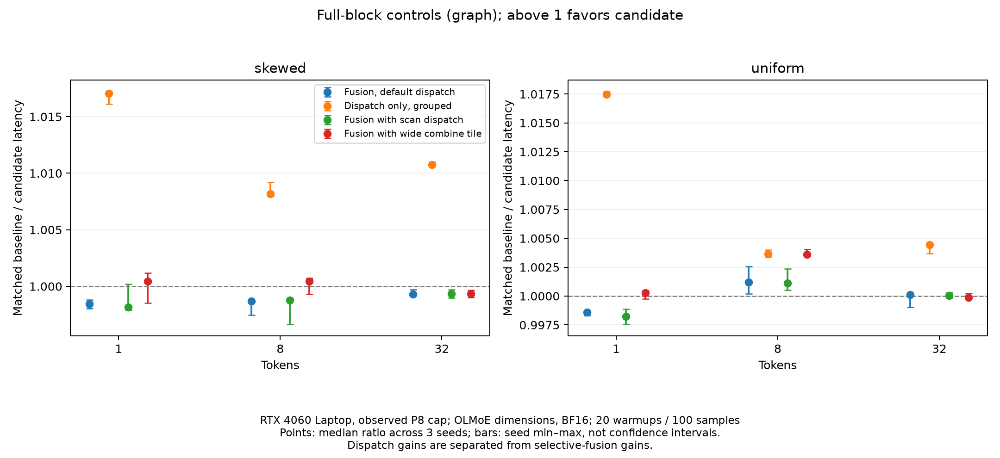
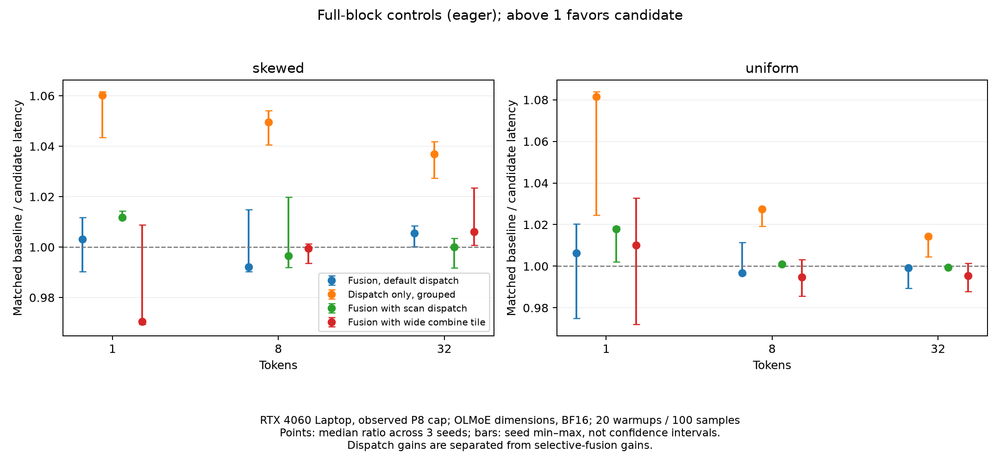

# Follow-up experiments

These experiments extend the initial midpoint evidence. All GPU measurements remain development results on a power/clock-constrained RTX 4060 Laptop (P8, 210 MHz SM / 405 MHz memory observed), PyTorch 2.9.0+cu128, Triton 3.5.0, WSL2. No L40S/A6000, Nsight memory-counter, full-model quality, or production-backend speedup is claimed.

## CUDA graphs

All 45 full-shape BF16 cases passed correctness. Graph replay includes device dispatch and reuses captured allocations. There are 20 eager warmups, 20 capture warmups, one capture, 20 replay warmups and 100 measured replays per case. T is flattened token count (recorded batch T, context 1). Attention and router computation are excluded.

The grouped/selective event-latency ratio ranges from 0.9627 to 1.0035 across 15 token/distribution cases. This does not establish a consistent fusion benefit. Eager and graph results are separate experiments; their ratios are not fusion speedups.

[Raw graph data](results/olmoe-bf16-graph.json) · [Graph plots](figures/graph)

## Threshold and tile search

The sweep tested 216 correct candidates: thresholds 0/1/2/4, combine columns 16/32/64 and reduction chunks 64/128/256, for T=1/8/32 and uniform/skewed routing. These are isolated down/combine graph timings with precomputed activations and metadata, 10 warmups per phase and 30 measurements. Their cache/allocation conditions differ from a complete block. Best-of-sweep selection is exploratory.

| Routes | T | Selected threshold | N × K | Best ms | Baseline before ms | Baseline drift |
| --- | --- | --- | --- | --- | --- | --- |
| uniform | 1 | 0 | 64 × 128 | 0.3886 | 0.3937 | -0.39% |
| uniform | 8 | 1 | 64 × 256 | 19.3224 | 19.4688 | -0.10% |
| uniform | 32 | 4 | 32 × 256 | 29.1384 | 29.3299 | -0.07% |
| skewed | 1 | 0 | 32 × 64 | 0.3871 | 0.4065 | -4.03% |
| skewed | 8 | 1 | 64 × 64 | 7.7373 | 7.7455 | +0.06% |
| skewed | 32 | 0 | 64 × 256 | 10.6880 | 10.7443 | +0.03% |

Threshold zero wins some cases. Small selected differences do not justify adopting a new default; the skewed one-token case also showed about 4% baseline drift. [Raw sweep](results/tuning-down-combine.json)

## Independent full-block controls: graph

18 cases use fresh seeds 11/22/33, T=1/8/32, uniform/skewed routes, randomized case and candidate order, and default grouped controls before and after each case. Each variant has 20 warmups and 100 samples. Maximum absolute baseline drift was 0.15%. Ratios use matching seeds; the default control is the mean of its before/after medians. Bars below are ranges over three seed cases, not confidence intervals. Repeated invocations are not treated as independent trials.

| Comparison | Routes | T | Median ratio | Seed range |
| --- | --- | --- | --- | --- |
| Fusion, default dispatch | skewed | 1 | 0.9984 | 0.9980–0.9988 |
| Fusion, default dispatch | uniform | 1 | 0.9986 | 0.9983–0.9986 |
| Fusion, default dispatch | skewed | 8 | 0.9987 | 0.9975–0.9988 |
| Fusion, default dispatch | uniform | 8 | 1.0012 | 1.0002–1.0026 |
| Fusion, default dispatch | skewed | 32 | 0.9993 | 0.9992–0.9997 |
| Fusion, default dispatch | uniform | 32 | 1.0001 | 0.9990–1.0001 |
| Dispatch only, grouped | skewed | 1 | 1.0170 | 1.0161–1.0172 |
| Dispatch only, grouped | uniform | 1 | 1.0175 | 1.0173–1.0177 |
| Dispatch only, grouped | skewed | 8 | 1.0082 | 1.0080–1.0092 |
| Dispatch only, grouped | uniform | 8 | 1.0036 | 1.0034–1.0040 |
| Dispatch only, grouped | skewed | 32 | 1.0108 | 1.0107–1.0110 |
| Dispatch only, grouped | uniform | 32 | 1.0045 | 1.0037–1.0045 |
| Fusion with scan dispatch | skewed | 1 | 0.9982 | 0.9979–1.0002 |
| Fusion with scan dispatch | uniform | 1 | 0.9983 | 0.9975–0.9989 |
| Fusion with scan dispatch | skewed | 8 | 0.9988 | 0.9966–0.9989 |
| Fusion with scan dispatch | uniform | 8 | 1.0011 | 1.0005–1.0024 |
| Fusion with scan dispatch | skewed | 32 | 0.9993 | 0.9990–0.9997 |
| Fusion with scan dispatch | uniform | 32 | 1.0000 | 0.9998–1.0003 |
| Fusion with wide combine tile | skewed | 1 | 1.0005 | 0.9985–1.0012 |
| Fusion with wide combine tile | uniform | 1 | 1.0003 | 0.9998–1.0005 |
| Fusion with wide combine tile | skewed | 8 | 1.0004 | 0.9993–1.0007 |
| Fusion with wide combine tile | uniform | 8 | 1.0036 | 1.0034–1.0040 |
| Fusion with wide combine tile | skewed | 32 | 0.9993 | 0.9990–0.9997 |
| Fusion with wide combine tile | uniform | 32 | 0.9999 | 0.9998–1.0002 |

[Raw controls](results/ablation-graph.json)

## Independent full-block controls: eager

18 cases use fresh seeds 11/22/33, T=1/8/32, uniform/skewed routes, randomized case and candidate order, and default grouped controls before and after each case. Each variant has 20 warmups and 100 samples. Maximum absolute baseline drift was 4.48%. Ratios use matching seeds; the default control is the mean of its before/after medians. Bars below are ranges over three seed cases, not confidence intervals. Repeated invocations are not treated as independent trials.

| Comparison | Routes | T | Median ratio | Seed range |
| --- | --- | --- | --- | --- |
| Fusion, default dispatch | skewed | 1 | 1.0032 | 0.9902–1.0118 |
| Fusion, default dispatch | uniform | 1 | 1.0062 | 0.9748–1.0203 |
| Fusion, default dispatch | skewed | 8 | 0.9921 | 0.9903–1.0148 |
| Fusion, default dispatch | uniform | 8 | 0.9967 | 0.9960–1.0113 |
| Fusion, default dispatch | skewed | 32 | 1.0055 | 1.0001–1.0084 |
| Fusion, default dispatch | uniform | 32 | 0.9992 | 0.9895–0.9996 |
| Dispatch only, grouped | skewed | 1 | 1.0602 | 1.0435–1.0617 |
| Dispatch only, grouped | uniform | 1 | 1.0814 | 1.0246–1.0840 |
| Dispatch only, grouped | skewed | 8 | 1.0495 | 1.0406–1.0542 |
| Dispatch only, grouped | uniform | 8 | 1.0275 | 1.0193–1.0282 |
| Dispatch only, grouped | skewed | 32 | 1.0369 | 1.0273–1.0419 |
| Dispatch only, grouped | uniform | 32 | 1.0143 | 1.0045–1.0149 |
| Fusion with scan dispatch | skewed | 1 | 1.0118 | 1.0112–1.0144 |
| Fusion with scan dispatch | uniform | 1 | 1.0178 | 1.0022–1.0190 |
| Fusion with scan dispatch | skewed | 8 | 0.9965 | 0.9919–1.0198 |
| Fusion with scan dispatch | uniform | 8 | 1.0009 | 1.0006–1.0013 |
| Fusion with scan dispatch | skewed | 32 | 1.0000 | 0.9918–1.0035 |
| Fusion with scan dispatch | uniform | 32 | 0.9994 | 0.9994–0.9998 |
| Fusion with wide combine tile | skewed | 1 | 0.9705 | 0.9694–1.0088 |
| Fusion with wide combine tile | uniform | 1 | 1.0101 | 0.9720–1.0329 |
| Fusion with wide combine tile | skewed | 8 | 0.9995 | 0.9937–1.0012 |
| Fusion with wide combine tile | uniform | 8 | 0.9948 | 0.9857–1.0032 |
| Fusion with wide combine tile | skewed | 32 | 1.0061 | 1.0007–1.0236 |
| Fusion with wide combine tile | uniform | 32 | 0.9953 | 0.9878–1.0014 |

[Raw controls](results/ablation-eager.json)

## Native PyTorch grouped-mm execution

The T=8 uniform BF16 profile contains 3 native grouped-mm calls, 192 individual matrix-multiply operator calls, and device-to-host offset copies. This is evidence of the host-loop fallback on this software/GPU, not execution of a fast single grouped kernel. The trace follows 20 warmups and records one invocation. Profiler durations are not used as benchmark latency. [Profile summary](results/native-profile.json) · [Trace](results/native-trace.json)

## Pretrained first-layer occupancy

A pinned OLMoE checkpoint (6d84c48581ece794365f2b8e9cfb043c68ade9c5) supplied 228.77 MiB of embedding, attention, normalization and router tensors. Later layers and expert MLP weights cannot affect the first router call, so the prefix can capture exact first-layer prefill dependencies without loading the full model. CPU BF16 capture uses upstream eager causal attention and FP32 rotary frequencies. Tiny random-model tests include exact equality with upstream pretrained-loading behavior.

The three authored repository probes are a narrow diagnostic sample, not a public-corpus or generation evaluation. Routes preserve FP32 probabilities before the model's BF16 cast. Replay with random expert weights remains distinct from pretrained block execution.

| Probe | Context tokens | Active experts | Singletons | Maximum occupancy |
| --- | --- | --- | --- | --- |
| technical | 88 | 60 | 4 | 71 |
| narrative | 87 | 64 | 1 | 79 |
| structured | 93 | 62 | 6 | 69 |

[Capture manifest and routes](first-layer-routes) · [Authored probes](../experiments/text-probes.json)

## Public-text routing probes

Three deterministic long paragraphs from a pinned, tokenized WikiText-2 test split were truncated to 128 tokens. Capture uses the same pretrained layer-0 prefix and CPU BF16 policy. This is a narrow diagnostic sample, not corpus-wide performance or generation evaluation. Source URL, commit, original line, file hash, prompt hash and token hash are retained without redistributing the text.

| Source line | Tokens | Active experts | Singletons | Maximum occupancy |
| --- | --- | --- | --- | --- |
| 4 | 128 | 60 | 2 | 90 |
| 2184 | 128 | 64 | 3 | 94 |
| 4357 | 128 | 62 | 2 | 104 |

[Public-text capture evidence](wikitext-routes) · [WikiText attribution and license](https://huggingface.co/datasets/Salesforce/wikitext)

## Pretrained expert-block validation

All 27 BF16 cases passed both the FP32 reference and upstream BF16 module comparison at atol 0.02 / rtol 0.03. Unlike route replay, these cases use actual checkpoint expert weights and actual hidden states from the first attention/norm prefix. The maximum relative L2 errors were 0.00317 versus FP32 and 0.00519 versus upstream BF16.

Graph timings use 20 warmups per phase and 100 samples, default sort dispatch, threshold 1 and a 32 × 128 combine tile. They include expert dispatch but exclude attention, normalization and router computation. T=1/8 rows are suffix subsets of prefill hidden states, not decode. Full-prompt cases contain 87–93 tokens. The three authored prompts do not establish model quality or later-layer behavior.

| Prompt | T | Phase | Backend | CUDA-event median ms |
| --- | --- | --- | --- | --- |
| technical | 1 | prefill_state_subset | triton_fused | 10.9481 |
| technical | 1 | prefill_state_subset | triton_hybrid | 11.0029 |
| technical | 1 | prefill_state_subset | triton_grouped | 11.0085 |
| technical | 8 | prefill_state_subset | triton_hybrid | 46.1926 |
| technical | 8 | prefill_state_subset | triton_grouped | 46.2669 |
| technical | 8 | prefill_state_subset | triton_fused | 49.1223 |
| technical | 88 | prefill | triton_fused | 99.2271 |
| technical | 88 | prefill | triton_hybrid | 83.6188 |
| technical | 88 | prefill | triton_grouped | 83.4924 |
| narrative | 1 | prefill_state_subset | triton_grouped | 11.0080 |
| narrative | 1 | prefill_state_subset | triton_hybrid | 11.0152 |
| narrative | 1 | prefill_state_subset | triton_fused | 10.9670 |
| narrative | 8 | prefill_state_subset | triton_grouped | 47.6134 |
| narrative | 8 | prefill_state_subset | triton_hybrid | 47.6022 |
| narrative | 8 | prefill_state_subset | triton_fused | 49.5939 |
| narrative | 87 | prefill | triton_hybrid | 89.4346 |
| narrative | 87 | prefill | triton_fused | 102.6463 |
| narrative | 87 | prefill | triton_grouped | 89.0839 |
| structured | 1 | prefill_state_subset | triton_hybrid | 11.0223 |
| structured | 1 | prefill_state_subset | triton_grouped | 11.0090 |
| structured | 1 | prefill_state_subset | triton_fused | 10.9732 |
| structured | 8 | prefill_state_subset | triton_fused | 48.0671 |
| structured | 8 | prefill_state_subset | triton_hybrid | 46.2674 |
| structured | 8 | prefill_state_subset | triton_grouped | 46.1906 |
| structured | 93 | prefill | triton_fused | 103.5633 |
| structured | 93 | prefill | triton_hybrid | 86.4046 |
| structured | 93 | prefill | triton_grouped | 86.3898 |

[Pretrained block evidence and tensor checksums](results/pretrained-block.json)

The pretrained artifact preserves a dirty-working-tree flag from concurrent report archiving. A [source audit](results/pretrained-block-provenance.md) verifies that the measured benchmark and kernel files match the recorded revision.

## Public-text checkpoint blocks, graph replay

All 27 cases passed the same two numerical comparisons. Maximum relative L2 error against FP32: 0.00316. Timing mode is cuda_graph, with 20 warmups and 100 measurements per variant (graph mode also records capture/replay warmups). Hardware, BF16 dimensions and expert-block scope match the development setup. Where present, T=1/8 are prefill-state subsets, not decode. Inputs/weights are pretrained; only backend order is randomized. These are narrow probe comparisons, not independent timing trials or corpus-level quality evaluation.

Within this mode, grouped/selective ratios span 0.9964–1.0001. Do not mix these numbers with the other timing mode or route-only replay.

| Probe | T | Grouped ms | Selective ms | Uniform fused ms |
| --- | --- | --- | --- | --- |
| wikitext-line-4 | 1 | 11.0060 | 11.0213 | 10.9804 |
| wikitext-line-4 | 8 | 43.5348 | 43.5384 | 44.4493 |
| wikitext-line-4 | 128 | 84.4692 | 84.7314 | 119.2934 |
| wikitext-line-2184 | 1 | 10.9906 | 11.0305 | 10.9737 |
| wikitext-line-2184 | 8 | 43.5072 | 43.5067 | 46.3631 |
| wikitext-line-2184 | 128 | 89.9302 | 90.0270 | 122.9865 |
| wikitext-line-4357 | 1 | 11.0126 | 11.0111 | 10.9599 |
| wikitext-line-4357 | 8 | 48.9544 | 48.9472 | 51.1964 |
| wikitext-line-4357 | 128 | 87.2622 | 87.5259 | 121.1428 |

[Raw supplemental evidence](results/pretrained-wikitext-graph.json)

## Authored-probe checkpoint blocks, eager

All 27 cases passed the same two numerical comparisons. Maximum relative L2 error against FP32: 0.00317. Timing mode is eager, with 20 warmups and 100 measurements per variant (graph mode also records capture/replay warmups). Hardware, BF16 dimensions and expert-block scope match the development setup. Where present, T=1/8 are prefill-state subsets, not decode. Inputs/weights are pretrained; only backend order is randomized. These are narrow probe comparisons, not independent timing trials or corpus-level quality evaluation.

Within this mode, grouped/selective ratios span 0.9517–1.0001. Do not mix these numbers with the other timing mode or route-only replay.

| Probe | T | Grouped ms | Selective ms | Uniform fused ms |
| --- | --- | --- | --- | --- |
| technical | 1 | 11.9112 | 12.5153 | 12.5317 |
| technical | 8 | 47.8602 | 47.9667 | 51.1186 |
| technical | 88 | 85.4728 | 85.6786 | 101.0826 |
| narrative | 1 | 12.2542 | 12.5143 | 12.6561 |
| narrative | 8 | 49.7859 | 49.8447 | 51.8605 |
| narrative | 87 | 91.0828 | 91.5246 | 104.9621 |
| structured | 1 | 12.2102 | 12.4800 | 12.2383 |
| structured | 8 | 47.8116 | 47.8454 | 49.7085 |
| structured | 93 | 88.6528 | 88.6441 | 105.4515 |

[Raw supplemental evidence](results/pretrained-eager.json)

## Public-text checkpoint blocks, eager

All 27 cases passed the same two numerical comparisons. Maximum relative L2 error against FP32: 0.00316. Timing mode is eager, with 20 warmups and 100 measurements per variant (graph mode also records capture/replay warmups). Hardware, BF16 dimensions and expert-block scope match the development setup. Where present, T=1/8 are prefill-state subsets, not decode. Inputs/weights are pretrained; only backend order is randomized. These are narrow probe comparisons, not independent timing trials or corpus-level quality evaluation.

Within this mode, grouped/selective ratios span 0.9823–1.0050. Do not mix these numbers with the other timing mode or route-only replay.

| Probe | T | Grouped ms | Selective ms | Uniform fused ms |
| --- | --- | --- | --- | --- |
| wikitext-line-4 | 1 | 12.5716 | 12.7980 | 12.7498 |
| wikitext-line-4 | 8 | 45.8491 | 45.9423 | 46.5347 |
| wikitext-line-4 | 128 | 86.2423 | 87.1112 | 121.7019 |
| wikitext-line-2184 | 1 | 11.7786 | 11.9117 | 12.3433 |
| wikitext-line-2184 | 8 | 45.1901 | 45.2741 | 48.0430 |
| wikitext-line-2184 | 128 | 92.0801 | 92.2552 | 125.2214 |
| wikitext-line-4357 | 1 | 12.1615 | 12.1836 | 12.4841 |
| wikitext-line-4357 | 8 | 51.2169 | 50.9629 | 53.3386 |
| wikitext-line-4357 | 128 | 88.9411 | 89.7961 | 123.4104 |

[Raw supplemental evidence](results/pretrained-wikitext-eager.json)

## Longer public-text prefill, graph replay

All 9 cases passed the same two numerical comparisons. Maximum relative L2 error against FP32: 0.00313. Timing mode is cuda_graph, with 20 warmups and 100 measurements per variant (graph mode also records capture/replay warmups). Hardware, BF16 dimensions and expert-block scope match the development setup. Where present, T=1/8 are prefill-state subsets, not decode. Inputs/weights are pretrained; only backend order is randomized. These are narrow probe comparisons, not independent timing trials or corpus-level quality evaluation.

Within this mode, grouped/selective ratios span 0.9607–0.9650. Do not mix these numbers with the other timing mode or route-only replay.

| Probe | T | Grouped ms | Selective ms | Uniform fused ms |
| --- | --- | --- | --- | --- |
| wikitext-line-4 | 512 | 92.0044 | 95.6370 | 311.0364 |
| wikitext-line-2179 | 512 | 93.2332 | 97.0465 | 311.8956 |
| wikitext-line-4341 | 512 | 93.3135 | 96.6943 | 311.9130 |

[Raw supplemental evidence](results/pretrained-wikitext-long-graph.json)

These longer inputs join adjacent WikiText source lines into contiguous passages of at least 4000 characters, then tokenize/truncate to 512 tokens. Start/end source lines and hashes are retained. Singleton counts span 0–1 across these three prompts. A zero count means threshold-1 fusion has no light-expert work to optimize. This is a separate probe set from the 128-token paragraph comparison.

The paired CUDA-event and synchronized wall medians differ by up to 9.28% in this run. The cause is unresolved; both clocks and raw samples are preserved. This additional measurement limitation requires validation on a stable host/device before interpreting small gains. The table above consistently uses CUDA-event medians.

## Matched router-inclusive upstream comparison

All 27 cases passed both numerical checks. These eager measurements include router projection, FP32 softmax, top-k selection, route-weight casting, dispatch and expert computation for every backend, with 20 warmups and 100 samples. Attention and normalization are excluded. The same pretrained authored probes and T=1/8/full prefill-state selections are used.

The HF row executes the actual Transformers OLMoE module. Its Python expert loop is a model reference, not a fast production grouped kernel. Compare selective against Triton grouped to isolate fusion. Comparing against HF also includes the shared grouped projection, activation and dispatch implementation changes. These rows cannot be combined with expert-only timings.

| Probe | T | HF module ms | Triton grouped ms | Selective ms |
| --- | --- | --- | --- | --- |
| technical | 1 | 25.1622 | 12.8307 | 12.9126 |
| technical | 8 | 74.1627 | 48.3523 | 48.9882 |
| technical | 88 | 121.2216 | 86.5270 | 86.4620 |
| narrative | 1 | 32.1203 | 12.3894 | 12.3341 |
| narrative | 8 | 75.4586 | 50.9455 | 50.5252 |
| narrative | 87 | 122.7423 | 91.9552 | 91.8344 |
| structured | 1 | 25.1935 | 12.4780 | 12.7012 |
| structured | 8 | 74.3496 | 49.2042 | 48.9861 |
| structured | 93 | 124.6044 | 89.4551 | 89.5718 |

[Router-inclusive raw evidence](results/pretrained-whole-moe.json)

## Interpretation

The measured fusion hypothesis remains unproven. Keep the grouped baseline and existing defaults, report dispatch separately, and rerun on the proposed cluster GPU with stable power/clocks. Broader real-route sampling, a competitive external grouped kernel, memory counters and full-model quality evaluation remain open work.
