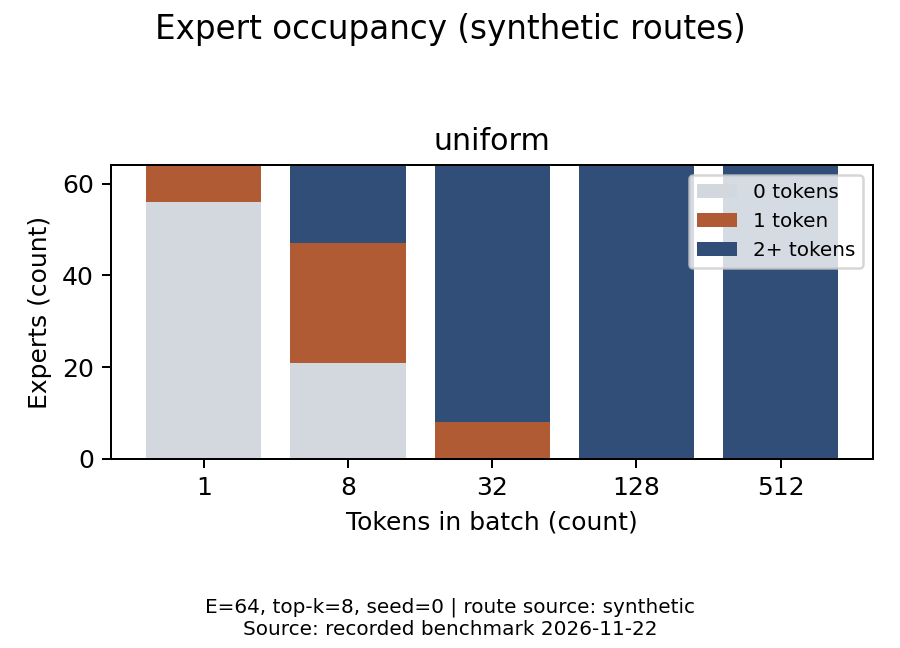

# PhaseMoE midpoint report

**Expert-Selective Fusion for Efficient Mixture-of-Experts Inference**

Aedin Pereira, Srikar Kovvuri, David Samtani.

Draft for team review — November 22, 2026. UNIs and confirmed roles pending team input.

## Project summary

PhaseMoE investigates whether expert occupancy can guide down-projection execution in a Mixture-of-Experts layer. Light experts use a fused down-projection and output combination kernel; heavy experts retain grouped GEMM. The hypothesis is that avoided intermediate writes and launches can outweigh the extra scheduling and reduction costs.

At this midpoint, we have a working PyTorch reference, grouped Triton baseline, selective and uniformly fused implementations, correctness tests, and reproducible single-block benchmarks. The initial measurements do not establish a consistent selective-fusion speedup. They are development evidence from a power-constrained laptop GPU, not results on the proposed L40S or A6000 cluster hardware.

The workload uses OLMoE-1B-7B dimensions: 64 experts, top-8 routing, hidden width 2048 and intermediate width 1024. We use synthetic random weights and controlled uniform, balanced and skewed routing. No pretrained checkpoint or public-text routing trace was used for the reported measurements.

## Baseline and experimental setup

Measured hardware: NVIDIA GeForce RTX 4060 Laptop GPU, 8.00 GiB reported device memory, compute capability 8.9 and 24 SMs. Software: Python 3.12.3, PyTorch 2.9.0+cu128, Triton 3.5.0, CUDA runtime 12.8, NVIDIA driver 621.14, Linux under WSL2. PyTorch uses one CPU thread.

The GPU was observed in P8 during sustained load, at 210 MHz SM and 405 MHz memory clocks, with a 15 W current power limit and software power/thermal caps reported. This is a material limitation on performance interpretation; a diagnostic snapshot is archived with the results. Clocks were not locked and Nsight memory counters were not collected.

Every case uses BF16 inputs, weights and intermediate storage, with FP32 dot/reduction accumulation. Routing probabilities use FP32 softmax and are not renormalized after top-k selection. Seeds are 0 for routing, 1 for weights and 2 for inputs. The expert weight tensors occupy 768 MiB. Token counts are 1, 8, 32, 128 and 512; the recorded batch/context interpretation is T by 1 flattened tokens. Large batches are prefill-like shape tests, not end-to-end prompt-prefill measurements.

For each backend and case, correctness and JIT compilation precede 20 warmup calls and 100 measured eager invocations. CUDA events measure stream elapsed time; synchronized perf_counter timing measures wall latency. Each sample includes dispatch/occupancy metadata, gate/up projections, SiLU multiplication, down projection and output reduction, including allocation and launch overhead. Router linear/top-k selection, attention, normalization and model loading are excluded. Raw samples and p10/p90 values are retained.

The PyTorch baseline launches separate GEMMs per active expert and is not called a grouped-GEMM backend. The controlled comparison uses our grouped Triton implementation with identical gate/up work and changes only down/combine execution. This implementation has not been compared with a production vLLM or MegaBlocks backend.

## Profiling and baseline analysis

All 60 full-shape BF16 cases passed comparison with an FP32 PyTorch reference using atol 0.02 and rtol 0.03. The largest relative L2 error was 0.00483 (0.483%). Independent token-wise tests additionally cover small shapes. Small random-weight cases were checked against the upstream Hugging Face OLMoE module in FP32 and BF16; this is integration validation, not pretrained-model evaluation.

Across all 15 routing/token configurations, the grouped-to-selective CUDA-event latency ratio ranged from 0.955 to 1.026 at occupancy threshold 1. Values above 1 favor selective fusion. This narrow range around parity, plus the constrained hardware and fixed backend order, does not support a robust speedup claim. Uniform fusion becomes substantially slower for larger batches.

For the uniform 8-token workload, 26 experts are singletons. Profiling shows that gate/up/activation is the largest phase. The measurements below are isolated-stage timings with precomputed inputs; they are not additive estimates of end-to-end latency. A separate PyTorch profiler trace confirms the projection-heavy execution pattern.

The traffic opportunity is small relative to weights in this case. Analytically, avoiding one BF16 projected row write and read saves 8 KiB per singleton assignment at hidden width 2048, while that expert's down weights occupy 4 MiB. For 26 singleton assignments, the avoided intermediate traffic is 208 KiB, versus 104 MiB of singleton down weights. These are tensor-size estimates, not measured DRAM traffic or cache misses.

### Uniform routing latency snapshot

Median CUDA-event latency in ms; OLMoE dimensions; BF16; RTX 4060 Laptop under observed P8 caps; eager; 20 warmups and 100 samples. Threshold 1.

| Tokens | PyTorch | Grouped | Selective | Uniform fused |
| --- | --- | --- | --- | --- |
| 1 | 23.013 | 11.901 | 12.396 | 12.294 |
| 8 | 87.635 | 60.003 | 60.639 | 65.762 |
| 32 | 121.650 | 89.594 | 89.334 | 96.278 |
| 128 | 128.963 | 91.333 | 93.170 | 125.339 |
| 512 | 142.036 | 96.593 | 100.202 | 314.802 |

### Isolated phases for uniform routing with eight tokens

Same device/dtype/shape; threshold 1; 20 warmups, 100 samples per stage; eager.

| Stage | CUDA event ms | Wall ms |
| --- | --- | --- |
| dispatch | 0.416 | 0.455 |
| gate up activation | 39.157 | 38.753 |
| heavy down | 7.760 | 7.843 |
| selective combine | 12.132 | 12.220 |
| full expert block | 60.599 | 59.711 |

## First optimization and implementation status

The selective kernel is implemented and GPU-tested. It gives each token/output tile one writer, computes light-expert down projections in chunks, and combines them with precomputed heavy-expert rows using the routing weights. Single-writer reduction avoids output atomics. Tests cover empty batches, mixed occupancy, thresholds 0/1/2/4, unaligned dimensions, and FP32/FP16/BF16.

The prototype avoids projected-row traffic for light experts but still reserves the full projected-output buffer in hybrid mode. It does not demonstrate an allocation reduction. The direct reduction can lose weight reuse and Tensor Core efficiency. CUDA-graph timing, phase profiling, and a randomized threshold/tile search are available as separate experiments; their results must not be mixed with the eager latency table.

## Future work and scope adjustments

First, rerun the exact benchmark on an L40S or A6000 with stable power and clock conditions, recording repeated trials and both eager and graph timing. Compare with a stronger external grouped-GEMM backend before claiming a general performance benefit.

Second, use isolated down/combine profiling to tune occupancy thresholds 1, 2 and 4 and combine tile sizes, then validate chosen settings on separate full-block runs and new seeds. Include the extra metadata/scheduling cost. Keep threshold 0 as a control.

Third, capture real prefill and decode routing traces from pretrained OLMoE on public text using the supplied capture script, replay the observed occupancies, and investigate whether their workload regimes differ from synthetic routing. Full-model latency, H100 evaluation and broad threshold generalization remain stretch goals.

The scope remains a single expert block with an explicit numerical policy. We have not established complete transformer-layer or end-to-end language-model speedups, quality preservation, measured memory-traffic reduction, or target-cluster performance.

## Blockers and limitations

The initial Windows environment was CPU-only and had insufficient free C-drive space for CUDA PyTorch. We resolved local GPU execution by creating an isolated Linux/WSL environment backed by D-drive storage. The remaining power/clock constraint is documented rather than treated as normal GPU performance.

Cluster execution and pretrained routing collection remain unverified. No external experiment-tracking dashboard is connected. Team UNIs, confirmed role assignments and the dashboard URL must be completed before submission. The supplied template mentions four to five students, while the proposal lists three; confirm the approved team-size arrangement with the course.

## Project links and references

Repository: https://github.com/SrikarKovvuri/moe-kernel-inference

Versioned experiment archive: https://github.com/SrikarKovvuri/moe-kernel-inference/tree/main/reports/results

Experiment tracking dashboard: pending team-provided accessible URL. The archive contains JSON evidence and figures; it is not a claim that a W&B dashboard exists.

Initial benchmark source revision: 386b9ce9bc902cd4dbbde7d5fe28eeaa535ae446. Profile source revision: 9cc40a737ccb6f2ed3c7d5ed9cf6f8d29159519b. Measurement date: 2026-11-22.

OLMoE model configuration: https://huggingface.co/allenai/OLMoE-1B-7B-0924/blob/main/config.json

OLMoE paper: https://arxiv.org/abs/2409.02060

Locality-aware MoE kernels: https://pytorch.org/blog/accelerating-moe-model/

Triton grouped GEMM tutorial: https://triton-lang.org/main/getting-started/tutorials/08-grouped-gemm.html

## Observed synthetic occupancy

Additional latency and occupancy figures are in [figures](figures).
